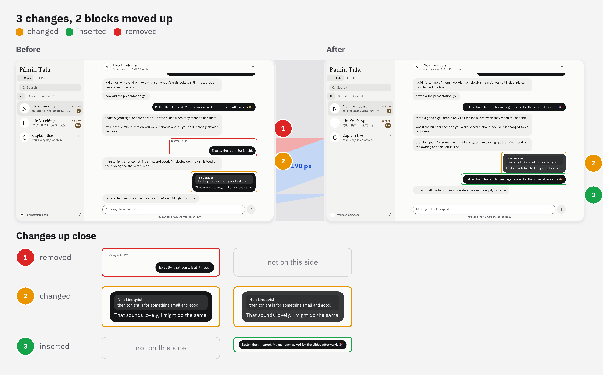
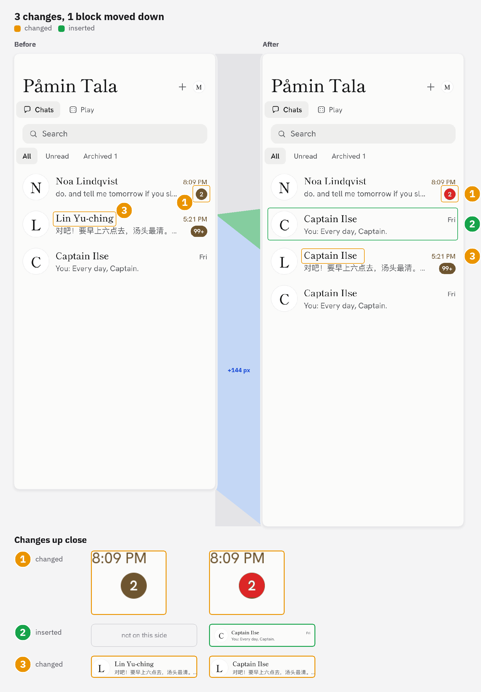

<h1 align="center">uidiff</h1>

<p align="center"><b>See exactly what changed between two screenshots.</b><br>
Moved content is lined up, and every real edit is boxed, numbered and labelled as changed, inserted or removed.</p>

<p align="center">
  <br>
  <sub>One message removed, one inserted, and one bubble a few shades lighter: easy to miss by eye, boxed by uidiff.</sub>
</p>

- **Changes, not pixels.** A pixel diff paints everything below an inserted row. uidiff aligns what only moved and reports it as one shift with its offset, so only real edits get a box.
- **Catches what eyes miss.** A colour a few shades off or a single changed word is boxed and shown side by side in a close-up.
- **One small native binary.** 604 KB, no runtime, 9.8 ms to report JSON for a 2560×1600 pair. PNG, JPEG and WebP in; a sheet and JSON out.

## Quick start

```sh
curl -fsSL https://uidiff.paminlabs.com/install.sh | sh
uidiff before.png after.png --scale 2 --annotate sheet.png
```

On Windows, in PowerShell:

```powershell
irm https://uidiff.paminlabs.com/install.ps1 | iex
```

[Homebrew, npm and other options](#more-ways-to-install) are below.

## When to use it

- **Checking an AI agent's UI work.** In vibe coding the screen changes every few minutes. Capture before and after, and the sheet shows what the agent really changed, including edits it did not mention.
- **Reviewing a pull request.** Attach the sheet to the PR so reviewers see each visual change, numbered, instead of comparing two screenshots by eye.
- **Visual regression tests.** Fail only when something actually changed, not when content above it shifted. The exit code and the `--json` report plug into CI.
- **Long pages and feeds.** Inserted or removed content moves everything below it; uidiff reports that as one shifted block with its offset, not as a page of differences.
- **Any platform with screenshots.** It reads only the two images, so the same command works for websites, iOS and Android apps, desktop apps, games, canvas and mini programs.

## What you get

### The sheet

`--annotate sheet.png` draws the before and after panes with numbered boxes: amber for changed, green for inserted, red for removed. The gutter between them shows which rows stayed and which shifted, and by how much. Each change gets a close-up of both sides below the panes.

<table>
  <tr>
    <td width="50%"></td>
    <td width="50%"></td>
  </tr>
  <tr>
    <td align="center"><sub>One message inserted. The gutter shows the thread moving down.</sub></td>
    <td align="center"><sub>Two changed regions and one inserted row. A block of rows shifted down.</sub></td>
  </tr>
</table>

### The report

`--json` prints one object for scripts, CI and agents. This is the report for the comparison at the top of this page:

```json
{
  "version": 1,
  "regions": [
    {"number": 1, "kind": "removed", "before": {"x": 1531, "y": 787, "width": 857, "height": 165}, "after": null},
    {"number": 2, "kind": "changed", "before": {"x": 1746, "y": 1114, "width": 642, "height": 204}, "after": {"x": 1746, "y": 924, "width": 642, "height": 204}},
    {"number": 3, "kind": "inserted", "before": null, "after": {"x": 1346, "y": 1136, "width": 1042, "height": 100}}
  ],
  "width": 2560,
  "height": 1600,
  "moves": [
    {"before": {"y": 968, "height": 366}, "after": {"y": 778, "height": 366}, "x": 860, "width": 1520},
    {"before": {"y": 1334, "height": 99}, "after": {"y": 1252, "height": 99}, "x": 860, "width": 1520}
  ]
}
```

Boxes are in device pixels. A region has a box on each side where it exists. A move's offset is its after `y` minus its before `y`, here −190 px and −82 px.

## How it compares

**One native binary and a report with labelled changes.** In the CLI comparison below, uidiff took less time and peak memory than pixelmatch, odiff and Iris. The accuracy rows cover 115 real and synthetic screenshot pairs with hand-checked ground truth. Pixel masks were grouped into boxes for scoring.

| | uidiff | Iris | odiff | pixelmatch |
| --- | ---: | ---: | ---: | ---: |
| Pairs matching the expected region count | **111 / 115** | 60 / 115 | 49 / 115 | 49 / 115 |
| Boxes on things that did not change | **4** | 46 | 147 | 131 |
| Moved content found with its offset | **56 / 56** | 56 / 56 | n/a | n/a |
| What you get | labelled regions, moves, a sheet | a mask | a mask | a mask |
| CLI time, 2560×1600 pair | **9.8 ms** | 65 ms | 103 ms | 379 ms |
| CPU time, same pair | **13.0 ms** | 80 ms | 127 ms | 419 ms |
| Peak RSS | **35.4 MiB** | 70 MiB | 50 MiB | 147 MiB |
| Install | **604 KB**, one file | 1.3 MB + Node | 2.4 MB | 0.76 MB + Node |

<sub>Timings are medians from 15 rotated rounds on Arm64 macOS. The uidiff column was refreshed independently on the original pair, alternating the current CLI with v0.0.3. Competitor figures are from the original run. Each comparison starts a new process. uidiff writes JSON, and Iris and pixelmatch include Node startup. See the <a href="bench/README.md">benchmark method</a>.</sub>

## Usage

```text
uidiff <before> <after> [--scale N] [--json] [--annotate <out.png>]
uidiff --batch < requests.jsonl
uidiff --help
uidiff --version
```

| Argument | Meaning |
| --- | --- |
| `<before>`, `<after>` | The two captures: PNG, JPEG or WebP. Different heights are fine; a different width is reported as added or removed columns. |
| `--scale N` | Device pixels per logical pixel (CSS px, points or dp), as a plain decimal such as `2` or `1.5`, with at most 15 digits after leading zeros and 22 decimal places after trailing zeros. Default `1`. It sets padding and merge distances in logical pixels; boxes stay in device pixels. |
| `--json` | Print the report as one JSON object instead of the region count. |
| `--annotate <out.png>` | Also write the sheet to this PNG. The file is replaced only once the sheet is complete. Large sheets are compressed on several cores; for a given uidiff version the PNG bytes are the same on every machine. |
| `--batch` | Run many comparisons in one process, reading JSON Lines on stdin. See [Batch](#batch). |
| `--help` | Print usage and exit 0. |
| `--version` | Print the installed version and exit 0. |

| Exit code | Meaning |
| --- | --- |
| `0` | No change regions detected. |
| `1` | Change regions found. |
| `2` | A comparison or usage error, reported on stderr. `SheetIsInput` means the sheet path names either input, including through a link. |

### Batch

`--batch` takes no other arguments. Each line of stdin is one JSON object: `before` and `after` are paths, `scale` is optional and uses the `--scale` grammar as a string such as `"2"`, and `annotate` optionally names a sheet to write. Other fields are ignored. Each input line gets one output line on stdout, in order and flushed as it is written:

```text
{"status":1,"report":{"version":1,"regions":[...],"width":1170,"height":2532,"moves":[]}}
{"status":2,"error":"FileNotFound","path":"missing.png"}
```

`status` is the exit code a single run would give. `report` is exactly the report `--json` prints. A failed comparison gives its error name and, when a file caused it, `path`, and the batch moves on. A line that is not a valid request gives `InvalidInput`, an invalid `scale` gives `InvalidScale`, and a line over 64 KiB gives `LineTooLong`. The batch exits with the highest status it printed. Sheets are byte-identical to a single run's. One process for many pairs skips the start-up each run pays.

Pass captures as files. `-` does not read stdin, and input pipes are unsupported. A symlink at the sheet path is replaced by the PNG itself, unless it points to an input, which raises `SheetIsInput`.

Connected changes smaller than four pixels are treated as noise. If the smaller capture has at most 1024 pixels, single-pixel regions can be reported.

For the best results, freeze animations, carets and timers, and keep fonts, locale and device scale the same for both captures.

## More ways to install

In a project, add it as a dev dependency so every machine and CI run uses the same version. npm picks the binary for the platform:

```sh
npm install --save-dev @pamin-labs/uidiff
npx uidiff before.png after.png
```

With Homebrew on macOS or Linux:

```sh
brew install pamin-labs/tap/uidiff
```

The install scripts download from uidiff.paminlabs.com, which also works where GitHub is unreachable. They verify the binary against `SHA256SUMS` and install it to `~/.local/bin` or `%LOCALAPPDATA%\Programs\uidiff`. Set `UIDIFF_VERSION` to pick a release, with or without the leading `v`:

```sh
curl -fsSL https://uidiff.paminlabs.com/install.sh | UIDIFF_VERSION=<version> sh
```

The [releases page](https://github.com/pamin-labs/uidiff/releases) also has standalone binaries, archives with license notices and checksums.

## Agent skill

The uidiff skill teaches agents that read `SKILL.md` how to capture a comparable pair, run the CLI and interpret the report.

```sh
npx skills add pamin-labs/uidiff        # install into this project (-g for every project)
npx skills update                       # update installed skills to their latest version
npx skills remove uidiff                # remove it
```

Inside a project the skill is recorded in `skills-lock.json`; commit it, and `npx skills install` restores the same version on another machine.

## License

MIT. Third-party notices are in [THIRD_PARTY_NOTICES](THIRD_PARTY_NOTICES).
