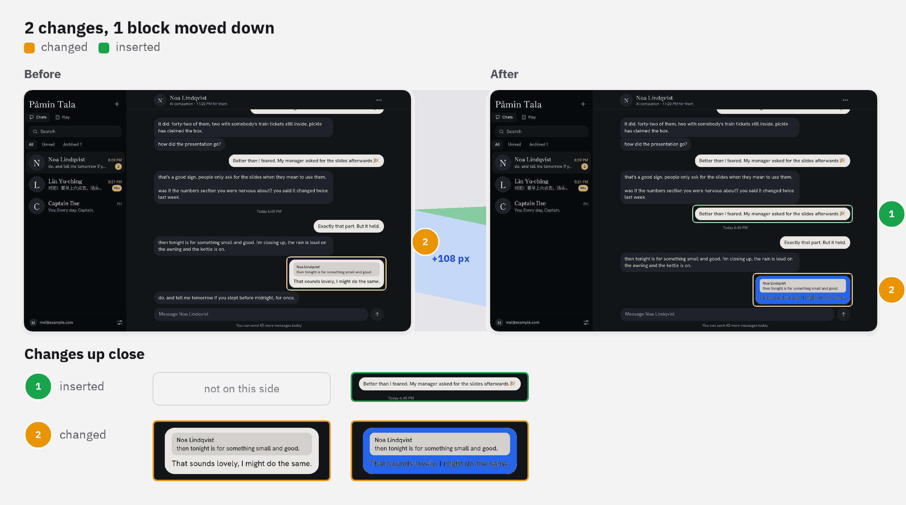
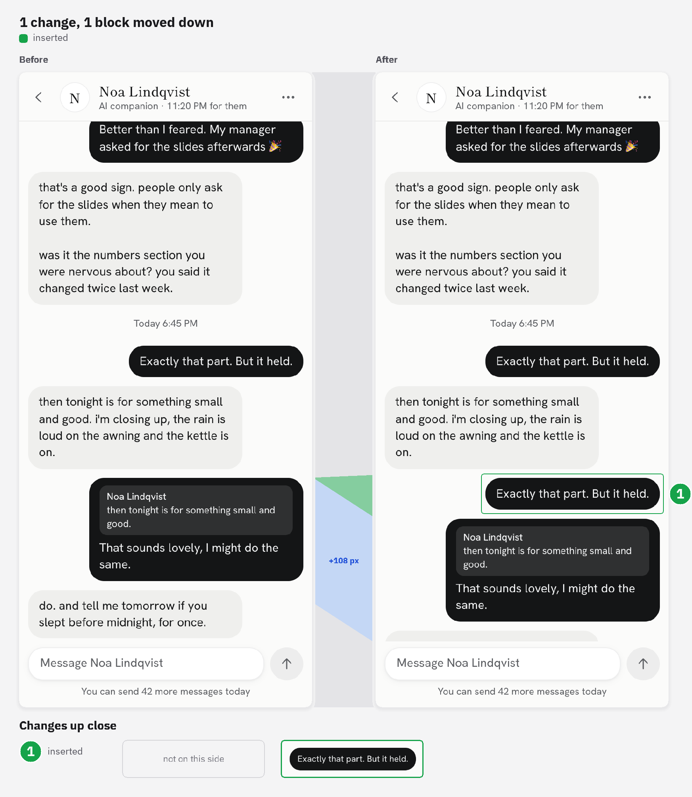
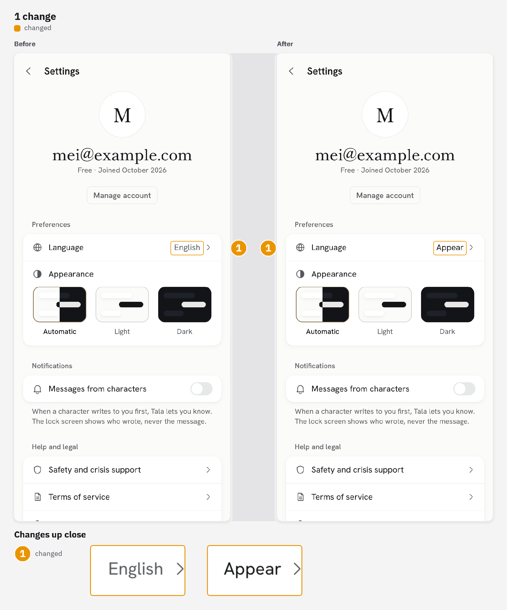

<h1 align="center">uidiff</h1>

<p align="center"><b>What changed between two screenshots, at a glance.</b><br>
Compare two captures and get a sheet with detected changes boxed, numbered and labelled.</p>

<p align="center">
  <br>
  <sub>One message inserted, one changed, and one block shifted down.</sub>
</p>

You change a UI, or a script does, or an AI agent does, and now you need to know what actually changed. A pixel diff tells you which pixels differ, so one inserted row paints everything below it. uidiff tells you what changed: it lines up rows that only moved, boxes each real edit, labels it **changed**, **inserted** or **removed**, and reports how far the rest moved. It reads nothing but the two images, so the same command works for websites, iOS and Android apps, desktop apps, games, canvas and mini programs. It earns its keep wherever a UI is iterated on, and most of all in vibe coding, where the screen changes every few minutes and you need to see what the agent really did.

## Why uidiff

**One native binary and a report with labelled changes.** In the CLI comparison below, uidiff took less time and peak memory than pixelmatch, odiff and Iris. The accuracy rows cover 115 real and synthetic screenshot pairs with hand-checked ground truth. Pixel masks were grouped into boxes for scoring.

| | uidiff | Iris | odiff | pixelmatch |
| --- | ---: | ---: | ---: | ---: |
| Pairs matching the expected region count | **111 / 115** | 60 / 115 | 49 / 115 | 49 / 115 |
| Boxes on things that did not change | **4** | 46 | 147 | 131 |
| Moved content found with its offset | **56 / 56** | 56 / 56 | n/a | n/a |
| What you get | labelled regions, moves, a sheet | a mask | a mask | a mask |
| CLI time, 2560×1600 pair | **11.4 ms** | 65 ms | 103 ms | 379 ms |
| CPU time, same pair | **14.2 ms** | 80 ms | 127 ms | 419 ms |
| Peak RSS | **35.4 MiB** | 70 MiB | 50 MiB | 147 MiB |
| Install | **604 KB**, one file | 1.3 MB + Node | 2.4 MB | 0.76 MB + Node |

<sub>Timings are medians from 15 rotated rounds on Arm64 macOS. The uidiff column was refreshed independently on the same pair. Each comparison starts a new process. uidiff writes JSON, and Iris and pixelmatch include Node startup. See the <a href="bench/README.md">benchmark method</a>.</sub>

## The sheet

`--annotate sheet.png` draws before and after panes, with numbered boxes in amber for changed regions, green for insertions and red for removals. The gutter shows stationary and shifted rows. Numbered close-ups appear below the panes. Panoramic captures use stacked overview strips.

<table>
  <tr>
    <td width="50%"></td>
    <td width="50%"></td>
  </tr>
  <tr>
    <td align="center"><sub>One message inserted. The alignment gutter shows the thread moving down.</sub></td>
    <td align="center"><sub>One settings label changed in place.</sub></td>
  </tr>
  <tr>
    <td colspan="2"></td>
  </tr>
  <tr>
    <td colspan="2" align="center"><sub>Two changed regions and one inserted row. A block of rows shifted down.</sub></td>
  </tr>
</table>

Render the procedural phone fixture with a local build.

```sh
zig build
zig-out/bin/uidiff tests/fixtures/images/phone-light/before.png tests/fixtures/images/phone-light/after.png --scale 2 --annotate sheet.png
```

## The report

`--json` prints each region's number, kind and box on each side, the before and after row ranges for moved content, and the canvas size. Subtract the before row's `y` from the after row's `y` for the signed offset. The exit code distinguishes a clean comparison, detected change regions and errors.

## Install

With Homebrew on macOS or Linux:

```sh
brew install pamin-labs/tap/uidiff
```

For npm projects, the package picks the right binary for the platform:

```sh
npm install --save-dev @pamin-labs/uidiff
npx uidiff before.png after.png
```

Without a package manager on macOS and Linux (x64 or arm64):

```sh
curl -fsSLO https://github.com/pamin-labs/uidiff/releases/latest/download/install.sh
sh install.sh
```

On Windows (x64 or arm64) in PowerShell:

```powershell
Invoke-WebRequest -UseBasicParsing https://github.com/pamin-labs/uidiff/releases/latest/download/install.ps1 -OutFile install.ps1
.\install.ps1
```

The installers verify the binary against `SHA256SUMS` and print the installed
path under `~/.local/bin` or `%LOCALAPPDATA%\Programs\uidiff`. Set
`UIDIFF_VERSION` to select a specific release, with or without the leading `v`.

The [releases page](https://github.com/pamin-labs/uidiff/releases) also has
standalone binaries, archives with license notices and checksums.

## Use

```text
uidiff <before> <after> [--scale N] [--json] [--annotate <out.png>]
uidiff --help
```

| Argument | Meaning |
| --- | --- |
| `<before>`, `<after>` | The two captures: PNG, JPEG or WebP. Different heights are fine; a different width is reported as added or removed columns. |
| `--scale N` | Device pixels per logical pixel (CSS px, points or dp), as a plain decimal such as `2` or `1.5`. Default `1`. It sets padding and merge distances in logical pixels; boxes stay in device pixels. |
| `--json` | Print the report as one JSON object instead of the region count. |
| `--annotate <out.png>` | Also write the sheet to this PNG. The file is replaced only once the sheet is complete. |
| `--help` | Print usage and exit 0. |

| Exit code | Meaning |
| --- | --- |
| `0` | No change regions detected. |
| `1` | Change regions found. |
| `2` | A comparison or usage error, reported on stderr. |

```sh
uidiff before.png after.png --scale 2                          # "3 regions"
uidiff before.png after.png --scale 2 --json > report.json
uidiff before.png after.png --scale 2 --annotate sheet.png
```

For the best results, freeze animations, carets and timers, and keep fonts, locale and device scale the same for both captures.

## Agent skill

The uidiff skill teaches agents that read `SKILL.md` how to capture a comparable pair, run the CLI and interpret the report.

```sh
npx skills add pamin-labs/uidiff        # install into this project (-g for every project)
npx skills update                       # update installed skills to their latest version
npx skills remove uidiff                # remove it
```

Inside a project the skill is recorded in `skills-lock.json`; commit it, and `npx skills install` restores the same version on another machine.
